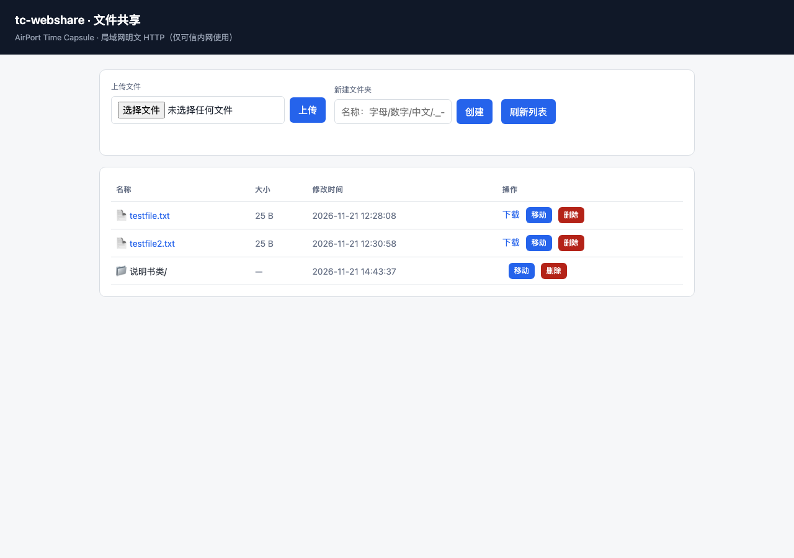

# tc-webshare — Static HTTP File Share for Apple AirPort Time Capsule / Apple AirPort Time Capsule 静态 HTTP 文件共享部署包

[中文](#chinese) | [English](#english)

---

<a id="english"></a>

## English

A plaintext HTTP file-sharing kit for **AirPort Time Capsule firmware 7.9.1**: browse, download and upload files on the LAN, coexist cleanly with the device's TimeCapsuleSMB installation, and roll back **with byte-level verification**.

This repository contains source, scripts and documentation only. All builds happen inside Docker; **no network device is contacted, no ssh/scp to real hardware is performed, and no credential file is read**.

> **Verification status — honest disclosure (updated in v1.0.2).** Build-side: the `tc_wb` Docker toolchain/sysroot compiled `httpd` and `upload.cgi`; both passed `nbfile` + `objdump -p` (pure static ARM ELF). Device-side: a **full deployment was performed and accepted** (INSTALL OK, 401/200, upload landed on the disk, `.htpasswd` 403, byte-exact rollback, Samba untouched). **A physical reboot was NOT performed**: boot-time autostart was validated by executing `boot_hook.sh` directly and checking idempotence. See the release notes at the end of this README and [CHANGELOG.md](CHANGELOG.md).

### 1. Device facts and hard constraints (on-device probe, authoritative)

| Item | Value |
| --- | --- |
| Firmware / OS | Apple AirPort Time Capsule 7.9.1 / NetBSD 6.0 evbarm / earmv4 (ARMv4, no Thumb/NEON) |
| Executable format | **Pure static ELF only** (these binaries have no dynamic linker; `ld.elf_so` on Flash is irrelevant to them) |
| Filesystems | `/` md0a 15 MB; `/mnt/Flash` flash2a 2.7 MB; `/mnt/Memory` tmpfs 16 MB. That is all of `/etc/fstab` |
| SATA disk | `/dev/ld0` exists but was **unmounted** (`/Volumes/` empty) at probe time; Apple mounts it on demand as `/Volumes/dk2` **or** `/Volumes/dk3`, the number changes every boot, it unmounts when idle, and **binaries cannot be executed from it** |
| Boot hook | `/mnt/Flash/boot.sh` belongs to **TimeCapsuleSMB**, ends with `exec /mnt/Flash/service manager`, is effectively read-only (`chmod u+w` / `u-w` window) |
| TimeCapsuleSMB | Installed and complete (`/mnt/Flash/service` manager, `tcapsulesmb.conf`, `seed_profile.sh`, diskd/wcifsnd guards), but smbd was **not running** and there were no runtime logs — must not be treated as a deployment precondition |
| Commands present | `/bin/sh`, `/bin/ls`, `/usr/bin/sed`, `/bin/df`, `/usr/bin/netstat`, `/usr/bin/tail`, `/bin/curl`, `/usr/bin/openssl` (`dgst -sha256`, `base64 -d`), plus `mkdir/cp/rm/mv/cat/ln/dd/date/sleep/ps/kill/sort/basename/expr` |
| Commands absent | `grep`, `head`, `find`, `awk`, **`dirname`**, `tr`, `cut`, `base64`, `sha256sum`, `id`, `mktemp`, `stat`, `readlink`, `tee`, `wget`, `nc`, `mount`, `disklabel`, `file`; **tc-toolbox is not installed** |

The missing `dirname` was a real deployment failure: the three deploy scripts
now compute their own directory with pure shell `${0%/*}` and need no external
helper. NAWK/mktemp-free temp files use `$$` suffixes placed on RAM tmpfs
(`/mnt/Memory/.tc_webshare_scratch`), because editing files on synchronous
Flash is extremely slow.
| Word size | 32-bit ⇒ **LFS mandatory**: `-D_FILE_OFFSET_BITS=64 -D_LARGEFILE_SOURCE` |

Every script sets `PATH=/bin:/sbin:/usr/bin:/usr/sbin` first (interactive SSH lacks `/sbin`). Scripts use only shell builtins plus the commands above; `install.sh` checks them with `require_cmds` before touching any path. QA confirmed Samba **is** running (139/445/548/22 LISTEN; the process is named `service`).

Performance figures from the earlier design (15–25 MB/s downloads, 8–15 MB/s uploads, ≤500 MB safe per file, concurrency lock = 1) are **estimates inherited from the thttpd design and have not been re-measured with bozohttpd**.

### 2. Why bozohttpd instead of thttpd

`build/build_thttpd.sh` keeps its historical filename but compiles **bozohttpd**, the NetBSD base HTTP server:

- its source ships inside the NetBSD source tree we already fetch, so no external thttpd tarball is needed;
- the compile switches are documented upstream (`-DDO_HTPASSWD -DNO_SSL_SUPPORT -DNO_LUA_SUPPORT`) and were reproduced with the real toolchain;
- it provides the same required features: CGI, directory index, HTTP Basic auth;
- the exact CLI differs from thttpd and from older bozohttpd releases. Verified against `main.c` / `bozohttpd.8`: `-b` daemonise, `-I <port>` listen port (**not** `-p`, which is `public_html`), docroot is a **positional** argument (`-d` is debug), `-C .cgi <handler>` suffix-maps CGI, `-X` index (off by default), `-H` hide dotfiles, `-P <pidfile>` PID file, `-U <user>` for privilege drop (deliberately unused). There is **no `-D` / `-g`** option.

```
Browser (LAN) --HTTP :8080--> bozohttpd (static ELF, slashdir=<SHARE_DIR>)
                               |-- GET /                    -> hidden management homepage (-x)
                               |                               -> .htpasswd 401 / download links
                               `-- POST|GET /<action>.cgi (-C .cgi -> Flash cgi_dispatch.sh)
                                                               |-- /upload.cgi -> static upload.bin
                                                               |                  -> upload.lock (O_EXCL, concurrency=1)
                                                               |                  -> <SHARE_DIR>/<basename>
                                                               |-- /list.cgi   -> static manage.bin (JSON listing)
                                                               |-- /mkdir.cgi  -> static manage.bin (mkdir)
                                                               `-- /delete.cgi -> static manage.bin (delete, top-level only)
```

**Why a unified dispatcher:** bozohttpd's `-C .cgi` maps one suffix to **one** handler; it cannot give upload/list/mkdir/delete separate handlers. Switching to `-c <cgibin dir>` would require a second `.htpasswd` and put program files next to user data. We therefore keep `-C .cgi` (which preserves the single docroot `.htpasswd` auth for every `.cgi` URL) and generate a `/bin/sh` dispatcher in managed Flash `bin/`. It restores `TC_SHARE_DIR` / `TC_STATE_DIR` (bozohttpd rebuilds the CGI environment) and routes by `SCRIPT_NAME`. `.htpasswd` is not recursive, but `-C` keeps every action inside the docroot, so **one** link protects GET `/` and all POSTs.

The management homepage is a **program file**: its master copy lives in managed Flash `etc/index.html`, and a hidden copy (`<SHARE_DIR>/.tc-webshare-index.html`) is published into the docroot and served as the default index via bozohttpd `-x`. `-H` hides it from the generated directory listing. Uninstall deletes exactly that file; all other docroot files are user data and are never touched.

### 3. Deployment path strategy

- `ROOT_DIR` (binaries, config, state, manifest) defaults to **`/mnt/Flash/.tc_webshare`** — persistent and executable. Flash is only 2.7 MB; `install.sh` aborts if `df -k /mnt/Flash` reports under 1024 KiB free for a fresh/partial install. A genuine update (boot.sh marker plus all three managed binaries already present) only needs **128 KiB** of headroom, because the same files are overwritten in place. Override with `TC_ROOT_DIR`.
- `SHARE_DIR` (user data) is resolved **at install and again at every boot** by `mount_data_volume()` / `detect_data_root()`: explicit `TC_SHARE_DIR` wins; otherwise we **actively ask Apple's diskd to mount** the internal disk with `/usr/bin/acp rpc diskd.useVolume "path:s:/Volumes/dk2"` (the typed `path:s:` prefix is mandatory; bare paths fail with `-6742`), poll `df -k` until it appears, and use `/Volumes/dk2/share/web`. dk3 is tried as a second candidate so a changed dkN is tolerated. **No formatting or partition changes are ever performed** — this only mounts a volume Apple already manages. If mounting genuinely fails we fall back to the **small but persistent** `<ROOT_DIR>/data` on Flash with a loud capacity warning; only if Flash is unavailable do we use volatile `/mnt/Memory/.tc_webshare/share` (also loudly warned). dk2 was confirmed on-device with ~1.8 TB free.
- Binaries never go on the disk (it unmounts on idle and cannot execute ELF); only data does.
- boot.sh has `set -eu` and ends with `echo 'boot: starting native manager'` + `exec /mnt/Flash/service manager`. The marker block is inserted **before the echo** and wrapped in `{ ...; } || true`, so our hook cannot stop Samba. Appending after `exec` would never run. chmod u+w/u-w brackets the write.
- Uninstall removes only the two marker lines and their contents and compares the rest of boot.sh line-for-line against `state/boot.nonweb` (`sha256sum` is absent; `openssl dgst` is available if a hash is ever needed). If data lives inside the managed root, uninstall preserves it unless `--purge-data` is given.
- Samba is currently running (139/445/548/22); silence would only produce a warning, never a deployment failure. TimeCapsuleSMB's files are never modified.

### 4. File tree

```
├── Dockerfile                 debian:bookworm cross-build image
├── run.sh                     docker build + volume + cross build
├── build/
│   ├── env.sh                 cross env; TOOLCHAIN_DIR/SYSROOT/SRC_ROOT overrides, CC includes --sysroot
│   ├── fetch_src.sh           idempotent NetBSD source download/unpack; reuses /wb-build/src
│   └── build_thttpd.sh        historical name; builds httpd + upload.cgi + manage.cgi
├── src/upload.c               streaming multipart upload CGI (v1.0.6: strict UTF-8 filenames; v1.0.5: no post-body stdin drain)
├── src/manage.c               list/mkdir/delete/move CGI (static, JSON, strict UTF-8 basenames)
├── deploy/
│   ├── common.sh              dependency-light on-device helpers
│   ├── install.sh / uninstall.sh
│   ├── boot_hook.sh           starts bozohttpd with verified flags
│   ├── index.html             management homepage template (program file)
│   ├── change_password.sh     on-device helper to rotate the Web password
│   ├── htpasswd.example       placeholder only
│   └── thttpd.conf            historical, informational only
├── docs/device-layout.md      on-device layout and ownership
├── docs/screenshots/          real-device UI screenshots (see its README)
│   ├── README.md              screenshot index and captions
│   └── web-ui-v1.0.6.png      management UI on the device
└── tests/                     local-only proof of the v1.0.5/v1.0.6 fixes
    ├── cgi_response_repro.c   mirrors bozohttpd's socketpair CGI topology
    ├── run_upload_response_test.sh  proves bug on pre-fix CGI, PASS on current
    ├── filename_validation_test.c   host test of the strict UTF-8 filename policy
    ├── run_filename_validation_test.sh  compiles and runs the policy test
    ├── index_ui_test.js       headless DOM/XHR test of the upload speed + move UI
```

### 5. Build (local / Docker, no hardware involved)

Prerequisites: Docker plus a NetBSD 7.2 evbarm/earmv4 toolchain. **The sysroot is mandatory**: without `--sysroot`, gcc uses host headers/libs and the result will not run. The `tc_wb` volume already contains a bootstrapped toolchain and source tree:

```
TOOLCHAIN_DIR=/wb-build/tc-earmv4-netbsd7/tools/bin
SYSROOT=/wb-build/tc-earmv4-netbsd7/obj/destdir.evbarm
SRC_ROOT=/wb-build/src
```

```sh
# Original SDK_DIR layout
SDK_DIR=/path/to/netbsd-7.2-evbarm-sdk BUILD_OUT=/path/to/stage ./run.sh

# tc_wb volume layout, offline (no SDK_DIR needed)
VOLUME=tc_wb NO_FETCH=1 \
TOOLCHAIN_DIR=/wb-build/tc-earmv4-netbsd7/tools/bin \
SYSROOT=/wb-build/tc-earmv4-netbsd7/obj/destdir.evbarm \
SRC_ROOT=/wb-build/src \
BUILD_OUT=/path/to/stage ./run.sh

# Force rebuild / reuse cached sources
NO_CACHE=1 ./run.sh
```

Equivalent direct compile (inside a container with `/wb-build` mounted):

```sh
CC='/wb-build/tc-earmv4-netbsd7/tools/bin/armv4--netbsdelf-eabi-gcc --sysroot=/wb-build/tc-earmv4-netbsd7/obj/destdir.evbarm'
CFLAGS='-O2 -g0 -static -fno-pic -fno-PIE -D_FILE_OFFSET_BITS=64 -D_LARGEFILE_SOURCE'
BOZO='-DDO_HTPASSWD -DNO_SSL_SUPPORT -DNO_LUA_SUPPORT -I/wb-build/src/libexec/httpd -I/wb-build/src/include'
for f in bozohttpd.c ssl-bozo.c auth-bozo.c cgi-bozo.c daemon-bozo.c \
         tilde-luzah-bozo.c dir-index-bozo.c content-bozo.c lua-bozo.c main.c; do
  $CC $CFLAGS $BOZO -c /wb-build/src/libexec/httpd/$f -o $f.o
done
$CC -static -o httpd *.o -lcrypt -lm
$CC $CFLAGS -o upload.cgi /path/to/tc-webshare/src/upload.c
```

Artifacts: `httpd` (bozohttpd) and `upload.cgi`. Every one must pass **both** checks:

```
nbfile <artifact>            # must say "ELF 32-bit LSB ARM EABI5 statically linked ..."
objdump -p <artifact>        # must contain no INTERP / DYNAMIC section
```

`fetch_src.sh` prefers `/wb-build/usr/src` (what the source tarballs produce) but detects and reuses the volume's `/wb-build/src`; it fails loudly if `SRC_ROOT` and `EXTRACT_DIR` disagree.

Local static checks (no toolchain needed):

```sh
for f in run.sh build/env.sh build/fetch_src.sh build/build_thttpd.sh \
         deploy/common.sh deploy/install.sh deploy/uninstall.sh deploy/boot_hook.sh; do
    sh -n "$f" || exit 1
done
```

### 6. Deployment (on the device)

Copy package and artifacts (sshd has no SFTP, use `-O`):

```sh
scp -O -r tc-webshare root@<TC-LAN-IP>:/mnt/Flash/.tc_webshare_pkg
scp -O build_out/stage/bin/httpd build_out/stage/bin/upload.cgi \
    root@<TC-LAN-IP>:/mnt/Flash/.tc_webshare_pkg/build_out/stage/bin/
```

Generate the crypt(3) hash on the build machine (e.g. `openssl passwd -1`) and deploy; the device has no `htpasswd`, so plaintext passwords are deliberately unsupported:

```sh
TC_WEB_PASS_HASH='$1$xxxx$....' ./deploy/install.sh
# Optional: TC_ROOT_DIR=... TC_SHARE_DIR=... ./deploy/install.sh
```

`install.sh` sets PATH, guards paths, detects install vs. update mode **before** checking free Flash space (an in-place update needs only 128 KiB, a fresh/partial install 1024 KiB), checks commands, tolerates inactive Samba, installs binaries/config/shim, writes credentials, inserts the `|| true`-wrapped marker block before the native-manager echo on fresh installs, verifies boot.sh's non-Web lines, starts bozohttpd with `-b -I 8080 -C .cgi ... -X -H -P ...` and checks port 8080.

**Flash is synchronous and slow.** Copying the 656 KiB `httpd` with `cp` took
~20 minutes and could make the device unreachable; the installer therefore
uses `dd bs=64k`, which took ~30 s in the real deployment. Scratch files for
boot.sh rewriting go to the 16 MB RAM tmpfs, never to Flash.

Upload test (from a LAN client):

```sh
curl -u admin:'<password>' -H 'Expect:' -F 'file=@/path/to/test.txt' \
     http://<device-lan-ip>:8080/upload.cgi
# Expect "OK files=1 bytes=..." and the file in SHARE_DIR.
# The -H 'Expect:' header is REQUIRED: bozohttpd replies 417 Expectation
# Failed when curl sends the default "Expect: 100-continue".
```

**v1.0.6:** uploaded file names use the **same strict UTF-8 policy** as
folder names, so a Chinese name such as `内网算力统筹与工作思路.docx`
(or an emoji name) is accepted instead of returning HTTP 400. Malformed
UTF-8, separators, `..`, controls and >200-byte names are still rejected;
hidden files such as `.gitignore` remain valid. See the v1.0.6 section of
[CHANGELOG.md](CHANGELOG.md).

**v1.0.5:** the upload response now ends immediately after the multipart body
is saved. If an older `upload.cgi` is still installed, the command above can
hang until `--max-time` even though `upload.log` says `status=OK`, and it
leaves `upload.lock` behind. Replace `upload.cgi` with the v1.0.5 binary before
repeating the test.

#### Web management UI (v1.0.5)



*(Screenshot captured on the device at v1.0.6; see [docs/screenshots/README.md](docs/screenshots/README.md).)*

Open `http://<device-lan-ip>:8080/` in a browser and pass the Basic auth
dialog. The hidden management homepage is served automatically; the top
toolbar offers **file upload** (multiple files, with a live progress bar),
**new folder**, refresh, and **change password** (v1.0.8). The table below shows top-level entries with
size, UTC mtime, download link, a **move** button, a **delete** button and
directory markers, rendered from `/list.cgi` (JSON) without any CDN.

**Bilingual UI (v1.0.9):** the toolbar's **Language** dropdown switches between
中文 and English instantly. All copy — including status messages, confirmation
dialogs, error branches and tooltips — comes from one inline `I18N` table; the
rendered file list is redrawn from cached data, so switching does not add a
`/list.cgi` request or disturb open modals. The choice is saved under the
`tcws-lang` key in `localStorage`; the first visit defaults to Chinese, and
`navigator.language` is deliberately ignored. If storage is unavailable or
holds an unknown value, the UI falls back to Chinese. This is a frontend-only
change: no CDN/library, no CGI or binary changes.

All selected files are posted in one multipart request; the progress bar
therefore reports the **whole batch** (`req.upload.onprogress`), and the
upload button is disabled until the response arrives. The label shows both
percentage and a smoothed live speed (e.g. `45% · 2.3 MB/s`); the completion
message appends the batch's average speed. Success, network error and a
synchronous `send()` failure all hide the bar and re-enable the button. No
`req.timeout` is set, so a slow multi-gigabyte upload is never cut off early.

Endpoints (all behind the same docroot `.htpasswd`):

| URL | Method | Purpose |
| --- | --- | --- |
| `/list.cgi` | GET | JSON list of top-level entries; dotfiles skipped |
| `/mkdir.cgi` | POST `name=...` (form-urlencoded) or GET query | create a folder |
| `/delete.cgi` | POST `name=...` (form-urlencoded) or GET query | delete one top-level file or empty directory |
| `/upload.cgi` | POST multipart | existing streaming uploader |
| `/move.cgi` | POST `name=...&to=...` (form-urlencoded) or GET query | move one top-level entry into an existing top-level folder |
| `/chpasswd.cgi` | POST `new_password=...` (form-urlencoded; optional `old_password=...`) | rotate the Basic-auth password in managed `etc/htpasswd` (v1.0.8) |

`move.cgi` never overwrites: `name == to` or an existing destination entry
returns 409, a symlink source/target or a non-directory target returns 403,
a malformed name returns 400, and a missing source/target returns 404. It moves
exactly one top-level entry one level down; there is no recursion and no way
to address a nested path.

Both names accept **printable ASCII (0x20–0x7E)** — spaces and common
symbols such as `! @ # $ % & ' ( ) + , ; = [ ]` are allowed — **plus
well-formed UTF-8 multibyte characters** (e.g. `家庭照片`,
`内网算力统筹与工作思路.docx`, emoji), up to **200 bytes** each. Rejected for folders: `/`, `\`, any leading
dot (which covers `.` and `..`), C0/C1/DEL control bytes and malformed UTF-8.
For uploaded files the same character rules apply, but a leading dot is
allowed (`.gitignore` is a valid upload name) while the complete `.` name, any
`..` substring, and any path separator are refused. Existing mkdir names
return 409. Malformed
UTF-8 (overlong encodings, surrogates, values above U+10FFFF) is rejected too,
so no byte sequence can bypass the basename checks. `list.cgi` returns raw UTF-8 in a `charset=utf-8` JSON body,
which `JSON.parse` handles directly. Browser `FormData` uploads do not send
`Expect: 100-continue`, so the curl-only `-H 'Expect:'` workaround is not
needed in the web UI.

**Deletion is deliberately narrow and irreversible.** It works only on the
`TC_SHARE_DIR` top level: symlinks are refused, regular files use `unlink()`,
directories use `rmdir()` (empty only, **never recursive**), dotfiles and the
two program files `.htpasswd` / `.tc-webshare-index.html` can never be named,
and the UI asks for confirmation. There is no trash and no undo — keep backups.
Responses: `200 {"ok":true,...}`, `400` bad name, `403` symlink/special file,
`404` missing, `409` directory not empty, `500` other errors.

#### Changing the Web password on the device

`deploy/change_password.sh` is installed to `<ROOT_DIR>/bin/change_password.sh`.
Run it **on the device** (it has `openssl` + `stty`); it regenerates the crypt(3)
hash in the managed `etc/htpasswd` in place. bozohttpd re-reads `.htpasswd` on
every request, so the new password is live **immediately** — no restart, no
reboot, no re-running `install.sh`.

```sh
# Interactive (prompts twice, hides input):
ssh root@<device-ip> 'sh /mnt/Flash/.tc_webshare/bin/change_password.sh'

# Or non-interactive: feed the password on stdin (never in argv/shell history):
printf '%s\n' 'NEW_PASSWORD' | ssh root@<device-ip> \
  'sh /mnt/Flash/.tc_webshare/bin/change_password.sh'
# Override the username with -u: ... | sh change_password.sh -u alice
```

The script preserves other users in `htpasswd`, keeps mode `0600`, rejects
empty/mismatched passwords, and writes the hash via `openssl passwd -1 -stdin`
(plaintext is never passed as an argument or stored in a file).

#### Changing the Web password from the browser (v1.0.8)

The toolbar's **修改密码** ("Change password") button opens a modal with a new
password and a confirmation field. Both are `type=password` (never echoed);
mismatches, empty values, control characters and values above 200 bytes are
refused before any request is sent. The form POSTs only `new_password` to
`/chpasswd.cgi`; a GET query is deliberately rejected so a password can never
land in a URL or browser history. The endpoint sits behind the same docroot
`.htpasswd` Basic auth as every other CGI — no bozohttpd flag changes.

The backend computes the `$1$` MD5-crypt hash **inside the CGI process** with
`crypt(3)` from statically linked libcrypt (the same library bozohttpd links).
Plaintext never reaches argv, a shell, a pipe, a child process or a log; it is
zeroed from the CGI's stack buffers before exit, and the response never echoes
the password or the hash. The target path is fixed at install time
(`TC_ETC_DIR`, with a `TC_STATE_DIR`-derived fallback for older dispatchers):
no request value can influence it. The write is atomic (same-directory temp
file + `rename()`, mode `0600`) and preserves every other htpasswd user.

An optional `old_password` field is checked against the current hash when
supplied (`403` on mismatch). The web UI does not send it: the request is
already Basic-authenticated and the specified modal has exactly two fields;
the check exists for stricter API/script callers. Responses: `200 {"ok":true}`,
`400` empty/malformed/overlong password, `403` old-password mismatch (when
sent), `500` hash/write failure.

**After a successful change the browser still holds the OLD Basic-auth
credentials.** The new password is live immediately (bozohttpd re-reads
`.htpasswd` per request), but this tab's cached credentials will get 401 on
the next request. The UI therefore does **not** auto-refresh, tells the user
to log in again with the new password, and turns any later 401 into an
explicit hint to close and reopen the browser (or clear this site's login
data). An XHR 401 cannot reliably raise a fresh browser auth dialog, and
sending deliberately bad credentials to force one would make things worse;
a clean re-open is the dependable path. Pressing 刷新列表 right after a change
shows that hint instead of a confusing generic 401.

This is the no-SSH equivalent of `deploy/change_password.sh`: same file, same
`$1$` hash format, same atomic / `0600` / preserve-other-users semantics. The
script remains for SSH or automation and is still the only interface that
takes an explicit `-u` username override.

### 7. Verification checklist

- [ ] `netstat -an | sed -n '/LISTEN/p'` shows 8080 (Samba 139/445/548 normally present)
- [ ] `curl -s -o /dev/null -w '%{http_code}' http://127.0.0.1:8080/` → 401
- [ ] authenticated GET / → 200 with a directory index, no `.htpasswd` listed
- [ ] POST to `/upload.cgi` → 200 and the file lands in the **resolved** share dir
- [ ] upload returns **immediately** after the file lands (no `--max-time` timeout); `state/upload.lock` is gone and no `upload.cgi` process remains
- [ ] web UI shows a live speed next to the percentage and auto-hides/refreshes on completion
- [ ] duplicate filenames get `.1` suffixes; bad filenames get 400
- [ ] a Chinese/emoji filename (e.g. `内网算力统筹与工作思路.docx`) uploads with 200 and lands with that exact name; malformed UTF-8 and `../` names still get 400
- [ ] the 移动 button opens a folder dropdown (excluding itself); with no folder it says `请先新建文件夹`; moving a Chinese-named file returns 200 and the file appears inside the target; a same-name destination returns 409
- [ ] web UI 修改密码: a mismatched pair is refused locally; a valid change returns 200 and the success message asks for a fresh login; a later 401 explains the stale cache; `etc/htpasswd` stays `0600` with other users intact
- [ ] `boot.sh` contains exactly one marker block, before the `starting native manager` echo, `|| true` wrapped; Samba still starts
- [ ] `state/boot.nonweb` matches the non-marker lines of boot.sh
- [ ] after reboot the boot hook re-mounts the disk via acp and serves from `/Volumes/dk2/share/web`; if acp fails, a loud tmpfs warning is printed
- [ ] TimeCapsuleSMB files are untouched; no tcn marker lines remain after uninstall

### 8. Rollback

```sh
./deploy/uninstall.sh              # keep user data
./deploy/uninstall.sh --purge-data # delete user data too
```

Removes the marker block, verifies boot.sh against the install-time snapshot, stops our httpd by pidfile, deletes only `ROOT_DIR`, and leaves user data and all TimeCapsuleSMB files alone. A second run prints `already clean`.

### 9. Security notes

Plaintext HTTP on a trusted wired LAN only; TLS is out of scope. `upload.c`
and `manage.c` now share the same strict RFC 3629 validator: printable ASCII
plus well-formed UTF-8 (Chinese/emoji) names are accepted, while malformed
sequences, control bytes, separators, `..` and >200-byte names are refused.
Uploaded files keep the older hidden-file behaviour (`.gitignore` is valid);
folders still reject every leading dot. Uploads use `O_EXCL|O_NOFOLLOW`,
never overwrite, get a numeric suffix on collision, and are serialised with
`upload.lock`. Deletion is limited to a validated top-level basename: `lstat()` rejects
symlinks, `rmdir()` refuses non-empty directories, no recursion is performed,
and program/dotfiles are unreachable by name. `/move.cgi` validates both
names the same way, requires the target to be a real (non-symlink) directory,
never overwrites an existing entry (409), and only moves one top-level entry
one level into an existing top-level folder — never across levels and never
out of `TC_SHARE_DIR`. Deletions are permanent. Credentials are supplied as a pre-computed crypt(3) hash; `htpasswd.example` is a placeholder. No plaintext password or credential file is read by this repository.

**v1.0.6 status:** built locally with the `tc_wb` cross toolchain and checked
with a host-side filename-policy test plus a headless UI test; **not yet deployed to the real device**
— QA verification is required. The hardware-validated baseline remains
v1.0.3 (see below); v1.0.5 fixed the upload response deadlock and v1.0.6
adds UTF-8 upload names plus the top-level→folder move endpoint. `httpd`
is unchanged. New sha256 values: `upload.cgi` `4582a0ca1bfe40adab27a6760d00fa78e4916307fac671ddb472efa818fd98b8`,
`manage.cgi` `dca20ba7541d682293daa973ba92f0a04fdd41af7c4a5e8c393a4093d35097b6` (previous v1.0.5 `upload.cgi` was
`04e35d26f7d25d86307f702f1f26a6343c9bb9e471cf5d2fadc648647c0a2cbd`).

### 10. License

GPL-3.0-or-later; see [LICENSE](LICENSE). `build/env.sh` preserves TimeCapsuleSMB's original copyright header. NetBSD / bozohttpd sources are downloaded from official releases at build time and are not redistributed here.

### 11. Release notes — real-device validation (v1.0.2)

**Validated on the real AirPort Time Capsule:**

- `install.sh` completed with `INSTALL OK`; static binaries execute on the device.
- Unauthenticated `GET /` → 401; authenticated GET → 200 with a directory index.
- File upload via `curl -H 'Expect:'` returned success and the file landed on the internal disk (the mounted `/Volumes/dkN` share).
- A request against `.htpasswd` itself returned 403.
- The boot.sh marker block is in place before the final `exec`, and TimeCapsuleSMB / Samba were left untouched.
- `uninstall.sh` restored boot.sh byte-for-byte and preserved user data (verified with the line-exact snapshot).

**Not validated:** no physical power cycle / reboot was performed. Boot-time autostart was exercised by running `boot_hook.sh` directly and confirming idempotence, including its acp disk-mount step.

**Real-device pitfalls fixed in this release:** missing `dirname`/`awk` (removed from deploy scripts), `curl` `Expect: 100-continue` → 417 (`-H 'Expect:'`), slow synchronous Flash writes (`dd bs=64k` instead of `cp`), and boot.sh scratch files moved to RAM tmpfs.

---

<a id="chinese"></a>

## 中文

面向 **AirPort Time Capsule 固件 7.9.1** 的明文 HTTP 文件共享部署包：局域网内浏览/下载/上传，与 TimeCapsuleSMB 干净共存，并支持**字节级可验证回退**。

本仓库只含源码、脚本和文档。构建在 Docker 中完成，**不连接真机、不读写任何凭据文件**。

> **验证状态（诚实声明，v1.0.2 更新）**：构建侧已用 `tc_wb` 卷内工具链/sysroot 编译出 `httpd` 与 `upload.cgi`，并通过 `nbfile` + `objdump -p` 双重静态校验。设备侧：**已完成完整真机部署并验收通过**（INSTALL OK、401/200、上传落盘硬盘、`.htpasswd` 403、回退逐字节还原、Samba 未动）。**未做物理断电重启**：开机自启是通过直接执行 `boot_hook.sh` 并验证幂等（含 acp 挂载）来确认的。详见文末发布说明与 [CHANGELOG.md](CHANGELOG.md)。

### 1. 设备事实与硬约束（真机探测，权威）

| 项目 | 值 |
| --- | --- |
| 固件 / 系统 | 7.9.1 / NetBSD 6.0 evbarm / earmv4（无 Thumb/NEON） |
| 可执行格式 | **仅纯静态 ELF**（Flash 上的 `ld.elf_so` 与我们的二进制无关） |
| 文件系统 | `/` md0a 15MB；`/mnt/Flash` flash2a 2.7MB；`/mnt/Memory` tmpfs 16MB，`/etc/fstab` 仅此三项 |
| 硬盘 | `/dev/ld0` 存在但探测时**未挂载**（`/Volumes/` 为空）；Apple 按需挂成 `/Volumes/dk2` 或 `dk3`，编号每次启动会变，空闲时卸载，**不能从其执行二进制** |
| 开机钩子 | `/mnt/Flash/boot.sh` 属于 **TimeCapsuleSMB**，结尾是 `exec /mnt/Flash/service manager`，写前需 `chmod u+w` |
| TimeCapsuleSMB | 已安装且完整，但 smbd **未运行**、无运行日志——不能作为部署前置条件 |
| 可用命令 | `/bin/sh`、`/bin/ls`、`/usr/bin/sed`、`/bin/df`、`/usr/bin/netstat`、`/usr/bin/tail`、部分 `/usr/bin/find` |
| 可用命令补充 | `/bin/curl`、`/usr/bin/openssl`（可 `dgst -sha256`、`base64 -d`）、`sort/basename/expr/dd/ps` 等 |
| 缺失命令 | `grep`、`head`、`find`、`awk`、**`dirname`**、`tr`、`cut`、`base64`、`sha256sum`、`id`、`mktemp`、`stat`、`readlink`、`tee`、`wget`、`nc`、`mount`、`disklabel`、`file`；**tc-toolbox 未安装** |

缺少 `dirname` 是本次真机部署的实际踩坑：三个部署脚本已改用纯 shell `${0%/*}` 自算目录，不再依赖外部命令。临时文件用 `$$` 后缀并放在 RAM tmpfs（`/mnt/Memory/.tc_webshare_scratch`），因为同步写 Flash 极慢。
| 字长 | 32 位 ⇒ **LFS 必开** |

每个脚本首先设 `PATH=/bin:/sbin:/usr/bin:/usr/sbin`（交互 SSH 缺 `/sbin`）。脚本只用 shell 内建与上述命令，动手前用 `require_cmds` 检查。QA 确认 Samba **正在运行**（139/445/548/22 LISTEN，进程名是 `service`）。旧文档里的性能数字是 thttpd 时代的经验值，**bozohttpd 未重新实测**。

### 2. 为何改用 bozohttpd

`build/build_thttpd.sh` 保留历史文件名，实际编译 **bozohttpd**（NetBSD base httpd）以及 `upload.cgi`、`manage.cgi` 两个静态 CGI：

- 源码就在我们已下载的 NetBSD 源码树里，不再需要外部 thttpd 包；
- 官方编译开关已用真工具链复现：`-DDO_HTPASSWD -DNO_SSL_SUPPORT -DNO_LUA_SUPPORT`；
- CGI、目录索引、Basic auth 功能等价；
- 参数与 thttpd 及旧版文档都不同（已查 `main.c` / `bozohttpd.8`）：`-b` 后台、`-I <port>` 端口（**不是** `-p`，那是 public_html）、docroot 是**位置参数**（`-d` 是 debug）、`-C .cgi <handler>` 后缀映射 CGI、`-X` 索引（默认关）、`-H` 隐藏点文件、`-P <pidfile>`、`-U <user>` 切用户（本包不用）。**没有 `-D` / `-g` 选项。**

**为何用统一分发器**：bozohttpd 的 `-C .cgi` 只能把一个后缀映射到**一个** handler，不能给 upload/list/mkdir/delete 分别配置。改用 `-c <cgibin目录>` 则需要第二份 `.htpasswd`，还会把程序文件混进用户数据目录。因此保留 `-C .cgi`（所有 `.cgi` URL 都在 docroot，受同一份 `.htpasswd` 保护），由 managed Flash `bin/` 中生成的 `/bin/sh` 分发器补回 `TC_SHARE_DIR` / `TC_STATE_DIR`（bozohttpd 会重建 CGI 环境），再按 `SCRIPT_NAME` 路由到三个静态二进制。

管理首页是**程序文件**：主副本放在 managed Flash `etc/index.html`，并把隐藏副本 `<SHARE_DIR>/.tc-webshare-index.html` 发布到 docroot，用 bozohttpd `-x` 作为默认首页；`-H` 让它不出现在自动目录索引里。卸载只精确删除该文件，docroot 中其他文件一律视为用户数据。

### 3. 部署路径策略

- `ROOT_DIR`（二进制/配置/状态）默认 **`/mnt/Flash/.tc_webshare`**，持久且可执行。Flash 只有 2.7MB，首次/不完整安装用 `df -k` 检查，低于 1024 KiB 直接失败；真正的原地更新（boot.sh 标记存在且三个管理二进制都已在位）只需 **128 KiB** 余量，因为同名文件原地覆盖、总量不增。
- `SHARE_DIR`（用户数据）在安装与每次开机时由 `mount_data_volume()` **主动挂载**：显式 `TC_SHARE_DIR` 优先；否则执行 `/usr/bin/acp rpc diskd.useVolume "path:s:/Volumes/dk2"`（`path:s:` 类型前缀必须带，裸路径会报 `-6742`），轮询 `df -k` 确认后使用 `/Volumes/dk2/share/web`；再尝试 dk3 以容忍编号变化。**只挂载、绝不格式化或改分区**。挂载失败才回退 Flash 上的 `<ROOT_DIR>/data`（持久但空间小，明确告警；Flash 不可用才退到易失的 `/mnt/Memory/.tc_webshare/share`）；dk2 真机已确认约 1.8TB 可用。
- 二进制不放硬盘（会卸载且不能执行），硬盘只放数据。
- boot.sh 带 `set -eu`，结尾是 `echo 'boot: starting native manager'` + `exec /mnt/Flash/service manager`。标记块插在 **echo 之前**并用 `{ ...; } || true` 包裹，避免我们的 hook 非零导致 Samba 起不来；写前 `chmod u+w`、写后 `u-w`。
- 卸载只删标记块，并逐行比对 boot.sh 其余内容与 `state/boot.nonweb`（设备无 `sha256sum`，必要时可用 `openssl dgst`）。数据若位于管理根目录内，默认卸载也会保留，除非 `--purge-data`。
- Samba 当前在运行；即使未监听也仅告警，不阻断部署。TimeCapsuleSMB 文件绝不改动。

### 4. 文件树

（同英文版，新增 `deploy/common.sh` 与 `deploy/change_password.sh`——后者安装到设备 `bin/`，用于在设备上修改 Web 密码；`deploy/thttpd.conf` 仅为历史说明文件；`tests/` 为纯本地验证脚本，不参与设备部署；`docs/screenshots/` 存放真机管理界面截图，见该目录 README 与上文界面章节。）

### 5. 构建（本机/Docker，不碰真机）

**`--sysroot` 是必填项**，否则 gcc 会用宿主机头文件/库，产物无法在设备上跑。`tc_wb` 卷里已有：

```
TOOLCHAIN_DIR=/wb-build/tc-earmv4-netbsd7/tools/bin
SYSROOT=/wb-build/tc-earmv4-netbsd7/obj/destdir.evbarm
SRC_ROOT=/wb-build/src
```

```sh
# 原 SDK_DIR 布局
SDK_DIR=/path/to/netbsd-7.2-evbarm-sdk BUILD_OUT=/path/to/stage ./run.sh

# tc_wb 卷布局，离线
VOLUME=tc_wb NO_FETCH=1 \
TOOLCHAIN_DIR=/wb-build/tc-earmv4-netbsd7/tools/bin \
SYSROOT=/wb-build/tc-earmv4-netbsd7/obj/destdir.evbarm \
SRC_ROOT=/wb-build/src BUILD_OUT=/path/to/stage ./run.sh
```

产物 `httpd`、`upload.cgi`、`manage.cgi` 必须全部通过 `nbfile`（含 `statically linked`）与 `objdump -p`（无 `INTERP`/`DYNAMIC`）校验。`fetch_src.sh` 优先 `/wb-build/usr/src`，也会复用卷里的 `/wb-build/src`；两者不一致时明确报错。

静态检查：`for f in run.sh build/*.sh deploy/*.sh; do sh -n "$f" || exit 1; done`

### 6. 部署（设备上执行）

```sh
# sshd 无 SFTP，必须 -O
scp -O -r tc-webshare root@<TC-LAN-IP>:/mnt/Flash/.tc_webshare_pkg
scp -O build_out/stage/bin/httpd build_out/stage/bin/upload.cgi \
    root@<TC-LAN-IP>:/mnt/Flash/.tc_webshare_pkg/build_out/stage/bin/

# 设备无 htpasswd，必须先在本地（openssl passwd -1）生成 crypt(3) hash
TC_WEB_PASS_HASH='$1$xxxx$....' ./deploy/install.sh
```

`install.sh` 会先设 PATH、做路径守卫，并**在 Flash 空间检查之前**判定首次安装/原地更新（原地更新只需 128 KiB，首次/不完整安装仍需 1024 KiB）；再检查命令、容忍 Samba 未启动；安装二进制、配置与 CGI 垫片；写入凭据；仅首次安装在 `starting native manager` 前插入 `|| true` 包裹的标记块；校验 boot.sh 非 Web 行；以 `-b -I 8080 -C .cgi ... -X -H -P ...` 拉起 bozohttpd 并检查 8080。

**Flash 是同步写入、极慢**：用 `cp` 写 656KB 的 `httpd` 曾耗时约 20 分钟并导致设备失联；安装脚本已改用 `dd bs=64k`，真机实测约 30 秒。boot.sh 的临时文件放在 16MB RAM tmpfs，绝不写 Flash。上传测试必须带 `-H 'Expect:'`，否则 bozohttpd 会因默认 `Expect: 100-continue` 返回 417。

#### 网页管理界面（v1.0.5）


*（截图为真机 v1.0.6 版本所摄；说明见 [docs/screenshots/README.md](docs/screenshots/README.md)。）*

浏览器打开 `http://<设备IP>:8080/` 并通过 Basic auth 后，会自动看到隐藏的管理首页：顶部工具栏提供**多文件上传**（带实时进度条）、**新建文件夹**、刷新、**修改密码**（v1.0.8）；下方表格显示顶层文件名、大小、UTC 修改时间、下载链接、**移动**按钮、**删除**按钮与目录标记，由 `/list.cgi`（JSON）渲染，完全离线、无外部 CDN。点击「移动」会从当前列表的文件夹中选择目标（排除自身），确认后调用 `/move.cgi`；若还没有任何文件夹，会提示「请先新建文件夹」。

**中英文切换（v1.0.9）**：工具栏的「界面语言 / Language」下拉框可在中文与
English 之间即时切换。所有文案（状态提示、确认弹窗、错误分支、提示文字等）
统一来自内联 `I18N` 词条表；文件列表用缓存数据重绘，切换语言不会额外请求
`/list.cgi`，也不会打断已打开的弹窗或清空输入。选择保存在浏览器
`localStorage` 的 `tcws-lang` 键，首次访问默认中文（不依据 `navigator.language`），
存储不可用或值非法时回退中文。此版本仅改前端，不引 CDN/库，不改 CGI 与二进制。

所选多个文件仍一次性 POST，因此进度条显示**整批**上传进度（`req.upload.onprogress`），上传期间禁用上传按钮。v1.0.5 起进度文字同时显示百分比与**平滑后的实时速度**（如 `45% · 2.3 MB/s`），完成消息附上整批平均速度；成功、网络错误与 `send()` 同步异常都会隐藏进度条并恢复按钮。故意不设 `req.timeout`，避免慢速网络上的大文件被误判超时。

**v1.0.5 修复的卡死**：旧版 `upload.c` 在解析完 multipart 后又去把 stdin 读到 EOF。bozohttpd 把同一个 AF_UNIX socketpair 同时作为 CGI 的 stdin/stdout，输出转发子进程一直持有对端，stdin 在 CGI 退出前永远不会有 EOF——于是 CGI 卡住、不发响应、浏览器停在 100% 且要手动刷新，客户端超时后还会残留 `upload.lock`。本版已移除该读取并补齐 `Status: 200 OK` 与 `fflush(stdout)`。本地可用 `tests/run_upload_response_test.sh` 复现旧版卡死并验证新版立即返回、进程干净退出、锁被释放。

接口（均受 docroot 同一份 `.htpasswd` 保护）：

| URL | 方法 | 用途 |
| --- | --- | --- |
| `/list.cgi` | GET | 顶层条目 JSON 列表，跳过所有点文件 |
| `/mkdir.cgi` | POST 表单 `name=...` 或 GET query | 新建文件夹 |
| `/delete.cgi` | POST 表单 `name=...` 或 GET query | 删除一个顶层文件或空目录 |
| `/upload.cgi` | POST multipart | 原有流式上传 |
| `/move.cgi` | POST 表单 `name=...&to=...` 或 GET query | 把一个顶层条目移动到已存在的顶层文件夹 |
| `/chpasswd.cgi` | POST 表单 `new_password=...`（可选 `old_password=...`） | 更新托管 `etc/htpasswd` 的 Basic auth 口令（v1.0.8） |

**v1.0.6 中文上传名**：上传文件名现在与文件夹名使用**同一套严格 UTF-8 校验**，`内网算力统筹与工作思路.docx`、emoji 名字等都能正常上传，不再返回 HTTP 400；畸形 UTF-8、分隔符、`..`、控制字节与超过 200 字节的名字仍拒绝，`.gitignore` 这类隐藏文件名仍可上传（详见英文版对应段落）。

`/move.cgi` **绝不覆盖**：`name == to` 或目标已有同名条目返回 409；软链源/目标或目标不是目录返回 403；非法名返回 400；源或目标不存在返回 404。只允许「顶层 → 一层已有的顶层文件夹」，不递归、不跨层、不会移出 `TC_SHARE_DIR`。

**在设备上修改 Web 密码**：`deploy/change_password.sh` 会安装到 `<ROOT_DIR>/bin/change_password.sh`。**在设备上**运行（设备有 `openssl` + `stty`），它会原地重算托管 `etc/htpasswd` 里的 crypt(3) hash。bozohttpd 每次请求都重读 `.htpasswd`，所以新密码**立即生效**——无需重启、无需 reboot、无需重跑 `install.sh`。

```sh
# 交互式（提示两次，输入不回显）：
ssh root@<设备IP> 'sh /mnt/Flash/.tc_webshare/bin/change_password.sh'

# 非交互式：从 stdin 喂入密码（绝不放进 argv / shell 历史）：
printf '%s\n' '新密码' | ssh root@<设备IP> \
  'sh /mnt/Flash/.tc_webshare/bin/change_password.sh'
# 用 -u 改用户名：... | sh change_password.sh -u alice
```

脚本会保留 `htpasswd` 中的其他用户、维持 `0600` 权限、拒绝空密码/两次不一致，并通过 `openssl passwd -1 -stdin` 生成 hash（明文既不作为参数也不写入文件）。

**网页直接改 Web 密码（v1.0.8）**：工具栏「修改密码」打开弹窗，输入新密码与确认密码（两者均为 `type=password`，不回显）。两次不一致、空密码、控制字符、超过 200 字节都会在本地拦下，不发出请求；确认后只把 `new_password` 以 form-urlencoded POST 到 `/chpasswd.cgi`（故意拒绝 GET query，避免密码进 URL/历史）。该端点与其他 CGI 一样受 docroot 同一份 `.htpasswd` 的 Basic auth 保护，bozohttpd 启动参数无需改动。

后端在 CGI 进程**内部**调用静态链接 libcrypt 的 `crypt(3)` 生成 `$1$` MD5-crypt hash（与 bozohttpd 链接的是同一套库）。明文不进 argv、shell、管道、子进程或日志，函数返回前从 CGI 栈缓冲清零；响应不回显密码或 hash。目标路径在安装时固定（`TC_ETC_DIR`；旧版分发器只有 `TC_STATE_DIR` 时从其父目录推导），任何请求参数都无法影响它。写入采用同目录临时文件 + `rename()` 的原子替换，权限 `0600`，并保留其他用户。后端支持可选的 `old_password` 二次校验（不匹配返回 `403`）；网页端不发该字段——请求已经过 Basic auth，且弹窗按需求只含两个输入框；该校验供更严格的脚本/API 调用方使用。响应：`200 {"ok":true}`、`400` 空/非法/超长密码、`403` 旧密码不匹配（若提供）、`500` hash 或写失败。

**改完密码后浏览器仍缓存旧口令**：新密码立即生效（bozohttpd 每请求重读 `.htpasswd`），但当前标签页的 Basic auth 缓存会导致下一次请求 401。因此界面**不自动刷新**，成功提示明确要求「用新密码重新登录」，并把之后的 401 改为「请关闭并重新打开浏览器（或清除本站登录信息）」的具体提示。XHR 的 401 不能可靠触发浏览器重新弹认证框，用错误凭据强行触发只会更糟，所以干净地重开浏览器是最稳妥的办法；改完立刻点「刷新列表」会看到这条提示，而不是莫名其妙的通用 401。

这条链路与 `deploy/change_password.sh` 是同一份 `etc/htpasswd`、同一种 `$1$` hash、同样的原子写入 / `0600` / 保留其他用户语义，只是无需 SSH；脚本仍供 SSH/自动化使用，且仍是唯一支持 `-u` 显式指定用户名的接口。

新建/删除/移动的名称接受**可打印 ASCII 字符（0x20–0x7E，含空格与 `! @ # $ % & ' ( ) + , ; = [ ]` 等常见符号）**以及合法 UTF-8 多字节字符（如 `家庭照片`），最长 **200 字节**；仅拒绝 `/`、`\`、前导点（含 `.`、`..`）、C0/C1/DEL 控制字符与畸形 UTF-8，空格和常见符号是允许的。重名建文件夹返回 409。畸形 UTF-8（overlong、代理区、超出 U+10FFFF）同样拒绝，任何字节序列都无法绕过 basename 检查。`list.cgi` 以 `charset=utf-8` 返回原始 UTF-8 JSON，`JSON.parse` 可直接解析。浏览器 `FormData` 不会发送 `Expect: 100-continue`，因此网页上传不需要 curl 的 `-H 'Expect:'` 补丁。

**删除范围刻意收窄且不可恢复**：仅作用于 `TC_SHARE_DIR` 顶层；拒绝符号链接；普通文件用 `unlink()`，目录只用 `rmdir()`（**仅空目录，绝不递归**）；点文件与 `.htpasswd` / `.tc-webshare-index.html` 两个程序文件无法被命名；界面会二次确认。没有回收站、没有撤销，重要数据请自行备份。返回码：`200 {"ok":true,...}`、`400` 非法名、`403` 软链/特殊文件、`404` 不存在、`409` 目录非空、`500` 其他错误。

### 7. 验证清单 / 8. 回退 / 9. 安全 / 10. 许可

见英文版对应章节：重点确认 8080 LISTEN、401 认证、网页「修改密码」弹窗（两次不一致本地拦截；成功后提示重新登录；之后的 401 给出清缓存指引；`etc/htpasswd` 仍为 0600 且其他用户保留）、`/upload.cgi` 上传落点（curl 必须加 `-H 'Expect:'`）、标记块在 `starting native manager` 之前且带 `|| true`、`state/boot.nonweb` 一致、开机后 boot hook 通过 acp 重新挂载硬盘并继续使用 `/Volumes/dk2/share/web`（失败时明确告警并回退 Flash 小容量数据目录）、TimeCapsuleSMB 未被改动。`./deploy/uninstall.sh` 默认保留用户数据（包括在管理目录内的回退数据），`--purge-data` 才删除。仅可信有线 LAN 使用明文 HTTP；凭据只以预生成 hash 传入；`manage.c` 对新建/删除/移动名称执行严格 RFC 3629 UTF-8 校验（合法中文放行，畸形序列、控制字符、分隔符、`..`、前导点、超 200 字节拒绝）；上传文件名在 v1.0.6 起使用同款校验，但保留隐藏文件名（`.gitignore`）可上传；删除仅限合法顶层 basename：`lstat()` 拒绝软链、`rmdir()` 拒绝非空目录、不递归、程序文件与点文件不可命名，且删除不可撤销；移动仅限合法顶层 basename，目标必须是非软链的真实目录，同名条目一律 409，不跨层、不移出共享目录且不可覆盖。GPL-3.0-or-later。

**v1.0.6 状态**：已用 `tc_wb` 交叉工具链在本机构建，并用本机文件名策略测试与无头 UI 测试验证；**尚未真机部署**，需 QA 验证后再上线。硬件上已验证的版本仍是 v1.0.3（见下）；v1.0.5 修复了上传响应死锁，v1.0.6 补齐中文 UTF-8 上传文件名并加入「移动到文件夹」。`httpd` 未改动。新 SHA-256：`upload.cgi` `4582a0ca1bfe40adab27a6760d00fa78e4916307fac671ddb472efa818fd98b8`、`manage.cgi` `dca20ba7541d682293daa973ba92f0a04fdd41af7c4a5e8c393a4093d35097b6`；上一版 v1.0.5 `upload.cgi` 为 `04e35d26f7d25d86307f702f1f26a6343c9bb9e471cf5d2fadc648647c0a2cbd`。

### 11. 发布说明 — 真机验证结果（v1.0.2）

**已在真机验证通过**：`install.sh` 完整执行并返回 INSTALL OK；未认证 `GET /` → 401、认证后 → 200 且可见目录索引；带 `-H 'Expect:'` 的 curl 上传成功且文件落在已挂载硬盘的共享目录；直接请求 `.htpasswd` → 403；boot.sh 标记块位于最终 `exec` 之前且 TimeCapsuleSMB / Samba 未被改动；`uninstall.sh` 逐字节还原 boot.sh 并保留用户数据。

**未验证**：没有做物理断电重启。开机自启通过直接执行 `boot_hook.sh`（含 acp 挂载步骤）并确认幂等来验证。

**本版修复的真机踩坑**：设备缺 `dirname`/`awk`（脚本改为纯 shell 实现）、curl 默认 `Expect: 100-continue` 导致 417（加 `-H 'Expect:'`）、同步 Flash 写盘过慢（`cp` 改 `dd bs=64k`）、boot.sh 临时文件改放 RAM tmpfs。
