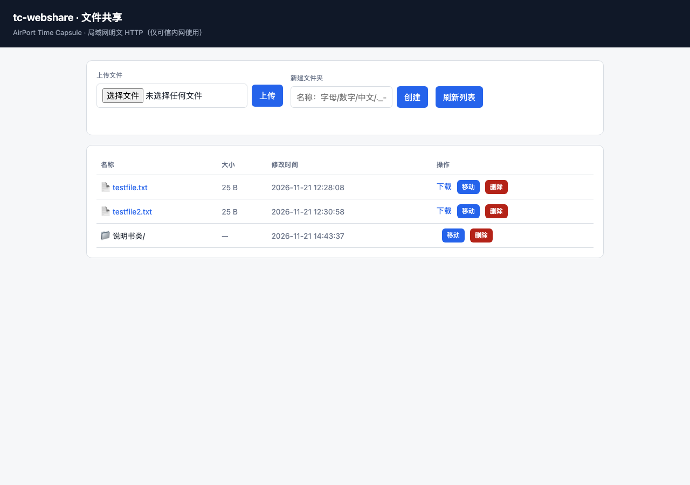

# tc-webshare 网页管理界面截图 / Web UI screenshots

本目录存放真机（Apple AirPort Time Capsule，固件 7.9.1）上 `tc-webshare` 网页管理界面的实际截图。

This directory holds real screenshots of the `tc-webshare` web management UI captured on the device (Apple AirPort Time Capsule, firmware 7.9.1).

## web-ui-v1.0.6.png — 最新管理界面（v1.0.6）

**拍摄方式**：本机 Chrome 无头模式访问 `http://192.168.31.44:8080/`（经 Basic auth），`--window-size=1280x900`，2026-11-21。

截图展示了修复完成后的完整功能：

| 区域 | 内容 |
|------|------|
| 页面标题 | `tc-webshare · 文件共享`，副标题标注"AirPort Time Capsule · 局域网明文 HTTP（仅可信内网使用）" |
| 上传文件 | 文件选择框 +「上传」按钮，上传时显示百分比与实时速度（如 `45% · 2.3 MB/s`），完成后自动隐藏并刷新列表 |
| 新建文件夹 | 输入框提示「名称：字母/数字/中文/_-」+「创建」按钮；**中文名可用**（v1.0.4 起） |
| 刷新列表 |「刷新列表」按钮 |
| 文件列表 | 名称 / 大小 / 修改时间 / 操作四列；示例中含 `testfile.txt`、`testfile2.txt` 与中文文件夹 `说明书类/` |
| 每行操作 |「下载」「移动」「删除」三个按钮（v1.0.6 起每行都有「移动」按钮，可把文件移入已有文件夹） |

**相关版本**：
- v1.0.3：首次加入网页管理界面（上传 / 列表 / 新建文件夹）
- v1.0.4：中文（UTF-8）文件夹名、上传进度条、安全删除
- v1.0.5：修复上传响应死锁（传完卡 100%）、新增实时速度显示
- v1.0.6：修复中文文件名被 400 拒绝、新增「移动文件到文件夹」

界面为纯原生 HTML/CSS/JavaScript，无外部 CDN 依赖，适配离线内网；所有操作端点（`/upload.cgi`、`/list.cgi`、`/mkdir.cgi`、`/delete.cgi`、`/move.cgi`）统一由 docroot 单份 `.htpasswd` 的 Basic auth 保护。

> 注：本页使用明文 HTTP，仅限可信有线内网。截图中显示的是测试用文件；真实部署时列表内容取决于共享目录 `SHARE_DIR`。
